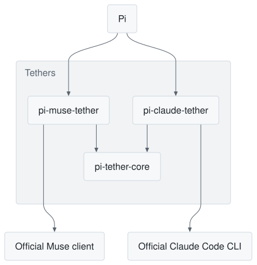

# pi-tether-core


A shared library for my [Pi](https://github.com/earendil-works/pi) tether extensions.

Hi, I built this as a shared library for all my tether extensions for Pi. A tether connects Pi to an official coding client, so you can use a subscription from inside Pi. Today that means [pi-muse-tether](https://github.com/kyraneth/pi-muse-tether) and [pi-claude-tether](https://github.com/kyraneth/pi-claude-tether), and I'm planning more. Each one has to solve the same hard problems, so I wrote those parts once and every tether behaves the same way. I wrote it with a coding agent.

You don't need to install this to use a tether. It comes with them, and it adds nothing to Pi on its own. You only need it if you want to connect Pi to another official client.

<picture>
  <source media="(prefers-color-scheme: dark)" srcset="https://raw.githubusercontent.com/kyraneth/pi-tether-core/main/assets/family-dark.svg">
  
</picture>

## What it handles

- Showing Pi's tools to the client over MCP, and returning a result only after Pi has saved it.
- Noticing when the history has changed, so a client isn't reused on the wrong conversation.
- Passing Pi's system prompt to the client unchanged, and refusing a mode the client can't support.
- Converting Pi's messages for a client, and ending a response cleanly on an error or abort.
- Private runtime folders, local authentication between processes, and ignoring late work from a stopped client.
- A diagnostic log that holds metadata only.

## Use it

You need Node 22.12 or newer on the 22 line, or Node 24 or newer. This is version 0.1, so the API may still change.

```sh
npm install pi-tether-core
```

```ts
import { projectionHash, matchesPrefix } from "pi-tether-core/request";

// Remember what the client has already seen, then check it before reusing the client.
const messages = [{ role: "user", content: "Hello" }];
const checkpoint = { length: messages.length, hash: projectionHash(messages) };
const unchanged = matchesPrefix(messages, checkpoint, projectionHash);
```

[docs/DETAILS.md](https://github.com/kyraneth/pi-tether-core/blob/main/docs/DETAILS.md) covers the tool bridge and the rest, with examples. Please report problems in the [issues](https://github.com/kyraneth/pi-tether-core/issues). [MIT license](https://github.com/kyraneth/pi-tether-core/blob/main/LICENSE).
